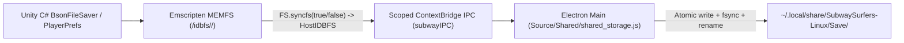

# Shared Save Storage Architecture (`~/.local/share/SubwaySurfers-Linux/Save/`)

## 1. Canonical Save Directory

Both `SubwaySurfers-SanFrancisco-Linux` and `SubwaySurfers-Beijing-Linux` read and write the **exact same physical files** in:

```text
~/.local/share/SubwaySurfers-Linux/
├── Save/
│   ├── cloud               # Primary Kiloo BSON + 28-byte SHA-1 save (142 top-level keys)
│   ├── cloud_old           # Previous cloud save generation maintained by BsonFileSaver
│   ├── local               # Install/session metadata BSON + 28-byte SHA-1 (30 top-level keys)
│   ├── local_old           # Previous local save generation
│   ├── PlayerPrefs         # Unity binary UnityPrf preferences
│   ├── .storage.lock       # Active exclusive PID + /proc/stat starttime lock
│   └── recovery/
│       ├── cloud.recovery       # Rolling verified backup taken before overwriting cloud
│       ├── local.recovery       # Rolling verified backup taken before overwriting local
│       └── PlayerPrefs.recovery # Rolling verified backup taken before overwriting PlayerPrefs
└── migration/
    ├── backups/            # SHA-256-verified backups of legacy IndexedDB profiles
    ├── migration_state.json
    └── migration_conflict.json (only created if an unresolved dual-profile conflict stops migration)
```

Legacy directories (`~/.config/SubwaySurfersSanfrancisco`, `~/.config/SubwaySurfersBeijing`, `~/.config/SubwaySurfersBeijing2`) are **never** active save destinations after migration.

---

## 2. How Unity Filesystem Operations Resolve to `Save/`

Instead of relying on Chromium's per-origin IndexedDB (`file__0.indexeddb.leveldb` vs `http_127.0.0.1_47321.indexeddb.leveldb`), both versions route Emscripten `IDBFS.syncfs` through `Source/Shared/host_idbfs_bridge.js` (`window.HostIDBFS`) and scoped IPC (`Source/Shared/preload_shared.js` -> `Source/Shared/shared_storage.js`):



- **Startup (`FS.syncfs(true)`):** Main process validates `cloud`, `local`, and `PlayerPrefs` in `Save/` (running automatic crash recovery if needed), computes `originHash = MD5(localOrigin)` (`141951c78e0371bca42ee67e7a9757dc` for Beijing on `:47321`, `30d5...` / `http://127.0.0.1:47322` for San Francisco), and populates MEMFS `/idbfs/<originHash>/` before Unity initializes.
- **Runtime & Exit (`FS.syncfs(false)`):** `HostIDBFS.persist` collects `/idbfs/<hash>/Save/{cloud,cloud_old,local,local_old}` and `PlayerPrefs` from MEMFS and sends them via `shared-save:commit`. Main process validates every buffer and atomically updates `Save/` on disk.

---

## 3. Save Compatibility (San Francisco 1.94.0 & Beijing 1.94.0)

Empirical inspection using `Source/Shared/bson_adapter.py` against live profiles confirmed:
- Both builds target **Subway Surfers 1.94.0** (`SanFrancisco` on Unity `2019.4.18f1`, `Beijing_2` on Unity `2019.2.0f1`).
- `Save/cloud` in both builds contains **142 identical top-level keys** with **0 BSON type mismatches**.
- `Save/local` in both builds contains **30 identical top-level keys** with **0 BSON type mismatches**.
- `PlayerPrefs` in both builds uses Unity's binary `UnityPrf` header.
- Bidirectional boot testing confirmed San Francisco's live profile boots cleanly in Beijing and Beijing's profile boots cleanly in San Francisco with full progression preservation.

---

## 4. First-Launch Migration Policy (`Source/Shared/migration.js`)

On first launch (when `Save/` does not yet contain valid saves):
1. Detects legacy IndexedDB profiles in `$XDG_CONFIG_HOME/SubwaySurfersSanfrancisco`, `SubwaySurfersBeijing2`, and `SubwaySurfersBeijing`.
2. Creates a SHA-256-verified backup in `~/.local/share/SubwaySurfers-Linux/migration/backups/pre_migration_<timestamp>/` before touching any data.
3. Extracts `/idbfs` entries from a **temporary copy** of the legacy LevelDB directory via `--internal-extract-legacy-idbfs`.
4. Applies deterministic resolution:
   - Neither profile has data -> initializes clean empty `Save/`.
   - Only San Francisco has data -> migrates San Francisco and validates SHA-1/`UnityPrf`.
   - Only Beijing has data -> migrates Beijing and validates SHA-1/`UnityPrf`.
   - **Both contain meaningful player data** -> **STOPS migration**, writes `migration_conflict.json`, preserves both backups, and instructs the user to select `--migrate-source=sanfrancisco` or `--migrate-source=beijing` (never silently overwrites).

---

## 5. Exclusive Locking & Atomic Writes

- **Process Lock (`Source/Shared/storage_lock.js`):** Acquired before migration or window creation using `fs.openSync('.storage.lock', 'wx')` with `{ pid, startTimeTicks, appName, version, hostname }`. Live instances block concurrent launches with exit code `2` and an error dialog. Dead/crashed PIDs (verified via `/proc/<pid>/stat`) are automatically recovered as stale locks.
- **Atomic Writes:** Every commit validates the 28-byte SHA-1 header (for BSON files) or `UnityPrf` magic (for `PlayerPrefs`), copies the previous valid primary file to `Save/recovery/<name>.recovery`, writes to `.<name>.tmp.<pid>.<ts>.<rand>`, calls `fs.fsyncSync()`, and performs an atomic POSIX `fs.renameSync()`.

---

## 6. Manual Backup & Restore

Ensure neither game is running, then:

```bash
# Backup
tar -czf "$HOME/subwaysurfers-save-backup-$(date +%Y%m%d).tar.gz" -C "$HOME/.local/share/SubwaySurfers-Linux" Save

# Restore
tar -xzf "$HOME/subwaysurfers-save-backup-YYYYMMDD.tar.gz" -C "$HOME/.local/share/SubwaySurfers-Linux"
```
