# Project Architecture Reconstruction

## 1. Architectural Overview

The Subway Surfers Linux AppImage is a multi-layered hybrid desktop application. Rather than running as a compiled native Linux C++/Mono/IL2CPP binary directly on X11/Wayland, the application wraps a high-performance **Unity WebGL (WebAssembly/IL2CPP)** game inside an **Electron/Chromium** desktop container.

This architectural approach allows the identical WebGL build created for web portals (specifically the Subway Surfers World Tour: San Francisco release, version 1.94.0) to operate as a self-contained, offline-capable Linux desktop application.

---

## 2. Mermaid Component Architecture Diagram

```mermaid
graph TD
    subgraph HostEnv ["Host Environment (Linux x86_64)"]
        Kernel["Linux Kernel (3.2+)"]
        Glibc["GNU C Library (glibc 2.25+)"]
        Display["Display Server (X11 / XWayland)"]
        AudioHost["Audio Server (ALSA / PipeWire / PulseAudio)"]
        GPUHost["GPU Hardware / Mesa / NVIDIA Driver"]
    end

    subgraph AppImagePkg ["AppImage Packaging Layer (Type 2)"]
        AIRuntime["AppImage ELF Runtime (189.6 KB)"]
        SquashFS["SquashFS 4.0 Compressed Archive (gzip, 133.8 MB)"]
        AppRun["Launcher Script (AppRun)"]
        Symlink["/tmp/SubwaySurfers Symlink Dispatcher"]
    end

    subgraph ElectronHost ["Electron Shell Runtime (v36.5.0 / Chromium 134)"]
        MainBinary["SubwaySurfers ELF Binary (188.4 MB)"]
        NodeRuntime["Node.js Main Process (main.js)"]
        V8Engine["V8 JavaScript & WebAssembly Engine"]
        GPUProcess["Chromium GPU Process (ANGLE EGL/GLESv2)"]
        SwiftShader["Google SwiftShader Fallback (libvk_swiftshader.so)"]
        MediaDecoder["FFmpeg Media Subsystem (libffmpeg.so)"]
        WindowMgr["BrowserWindow (1080x720, Frameless/Autohide)"]
    end

    subgraph WebContainer ["Web Application Platform Layer"]
        IndexHTML["Container Page (html/index.html)"]
        StorageShim["IDBFS IndexedDB Storage Layer (4399.js)"]
        PortalShims["Poki SDK & Ad Stubs (poki-sdk.js, prebid stub)"]
        UnityLoader["Unity WebGL Loader (UnityLoader.2019.2.js)"]
        ConfigJSON["Configuration Descriptor (SanFrancisco.json)"]
    end

    subgraph UnityEngine ["Unity WebGL & IL2CPP Engine (v2019.4.18f1)"]
        VFS["Emscripten Virtual File System (UnityWebData 1.0)"]
        WASMModule["WebAssembly Engine & Game Logic (SanFrancisco.wasm.code.unityweb)"]
        JSGlue["Emscripten JS Runtime Glue (SanFrancisco.wasm.framework.unityweb)"]
        IL2CPPMeta["IL2CPP Metadata v24 (global-metadata.dat)"]
        BootCfg["Boot Configuration (boot.config)"]
    end

    subgraph GameSystems ["Subway Surfers Gameplay Subsystems"]
        CoreGame["Core Game Assemblies (Assembly-CSharp.dll)"]
        PlayerSub["Player Controller & State (Jake, Tricky, Fresh, etc.)"]
        TrackSub["Endless Track Generator & Collision Physics"]
        ItemSub["Powerups (Jetpack, SuperSneakers, CoinMagnet)"]
        ShopSub["Boards, Outfits, Missions, High Scores"]
        AudioSub["Audio Engine (24 SFX Streams, 21 Music/Loop Streams)"]
    end

    subgraph StorageLayer ["Persistence & Assets Layer"]
        AssetBundle["Serialized Game Bundle (data.unity3d / level0)"]
        AudioBundles["Raw AAC Media Streams (resources.resource, sharedassets1.resource)"]
        UserSave["PlayerPrefs / IndexedDB (~/.config/SubwaySurfersSanfrancisco)"]
    end

    %% Wiring connections
    Kernel --> MainBinary
    Glibc --> MainBinary
    Display --> WindowMgr
    AudioHost --> MediaDecoder
    GPUHost --> GPUProcess
    
    AIRuntime --> SquashFS
    SquashFS --> AppRun
    AppRun --> Symlink
    AppRun --> MainBinary

    MainBinary --> NodeRuntime
    MainBinary --> GPUProcess
    MainBinary --> MediaDecoder
    GPUProcess -.->|Fallback| SwiftShader
    NodeRuntime --> WindowMgr
    WindowMgr --> IndexHTML

    IndexHTML --> StorageShim
    IndexHTML --> PortalShims
    IndexHTML --> UnityLoader
    UnityLoader --> ConfigJSON

    UnityLoader --> VFS
    VFS --> BootCfg
    VFS --> IL2CPPMeta
    VFS --> AssetBundle
    VFS --> AudioBundles

    UnityLoader --> WASMModule
    WASMModule <--> JSGlue
    WASMModule --> V8Engine
    WASMModule --> IL2CPPMeta

    WASMModule --> CoreGame
    CoreGame --> PlayerSub
    CoreGame --> TrackSub
    CoreGame --> ItemSub
    CoreGame --> ShopSub
    CoreGame --> AudioSub

    StorageShim --> UserSave
    AudioSub --> AudioBundles
    TrackSub --> AssetBundle
    PlayerSub --> AssetBundle
```

---

## 3. Subsystem Breakdown and Analysis

### 3.1 AppImage Packaging & Isolation Subsystem
- **Packaging Format**: AppImage Type 2.
- **Embedded Filesystem**: SquashFS version 4.0, gzip compression, NFS exportable.
- **Payload Offset**: Exactly `189632` bytes from the file origin.
- **Mount Mechanism**: Mounted at runtime using FUSE via bundled `squashfuse` runtime header.
- **Isolation Limitations**: Operates with standard user permissions. Unprivileged user namespaces are evaluated by `AppRun`.

### 3.2 Host Platform Shell (Electron / Chromium)
- **Version**: Electron `36.5.0` (Chromium `134.0.6998.35`, Node.js `22.14.0`, V8 `13.4`).
- **Main Executable**: `SubwaySurfers` (ELF 64-bit PIE, unstripped, RPATH `$ORIGIN`).
- **Process Architecture**:
  - Main Process: Runs Node.js, manages application lifecycle and `BrowserWindow`.
  - Renderer Process: Sandboxed browser process hosting `index.html`.
  - GPU Process: Dedicated Chromium process managing OpenGL ES / EGL / Vulkan contexts.
  - Crashpad Process: `chrome_crashpad_handler` monitoring process health.

### 3.3 Web Platform & Bridging Subsystem
- **Container**: `html/index.html`.
- **Portal Stubs**:
  - `poki-sdk.js` / `poki-sdk-core.js`: Local mock of the Poki web publishing SDK. It intercepts ad requests (`rewardedBreak`, `commercialBreak`) and resolves promises immediately, enabling offline continuous play without ad interruptions.
  - `prebid4.12.0.js`: 0-byte stub preventing ad-auction network requests.
  - `4399.js`: Handles virtual filesystem mounting (`/idbfs`), fullscreen requests, and browser event listeners.

### 3.4 Unity WebGL Runtime Subsystem
- **Version**: Unity `2019.4.18f1`.
- **Loader**: `UnityLoader.2019.2.js`.
- **Virtual Packaging**: `UnityWebData 1.0` binary container packaging 7 key files into a contiguous memory block.
- **Engine Core**: Compiled to WebAssembly (`SanFrancisco.wasm.code.unityweb`, 25.77 MB).
- **Emscripten Layer**: `SanFrancisco.wasm.framework.unityweb` providing memory management, heap allocation, string marshaling, and browser WebGL/WebAudio binding calls.

### 3.5 Game Logic Subsystem (IL2CPP)
- **Backend**: Unity IL2CPP (C# source compiled to C++, then compiled via Emscripten/Clang to WebAssembly).
- **Metadata**: `Il2CppData/Metadata/global-metadata.dat` (IL2CPP version 24).
- **Core Assembly**: `Assembly-CSharp.dll`, implementing:
  - `CharacterController`, `PlayerMovement`, `StumbleDetection`, `DeathCelebration`.
  - `TrackManager`, `TrackChunkPool`, `CurveDistortionManager`.
  - `CoinManager`, `CoinMagnet`, `JetpackController`, `SuperSneakersController`.
  - `HoverboardController`, `HoverboardParticleSystem`.
  - `ShopManager`, `CharacterUpgradeSystem`, `DailyQuestsManager`.

### 3.6 Graphics Rendering Subsystem
- **APIs**: WebGL 2.0 (primary) / WebGL 1.0 (fallback).
- **Translation Pipeline**: WebGL calls from WASM -> Emscripten -> Chromium GPU Process -> ANGLE (`libEGL.so`, `libGLESv2.so`) -> Host OpenGL/Vulkan driver.
- **Software Fallback**: Google SwiftShader (`libvk_swiftshader.so` + `vk_swiftshader_icd.json`).
- **Shaders**:
  - Curved horizon shader: `Custom/Distorted/Character seperated alpha`.
  - UI Shaders: `GUI/Text Shader`, `Unlit/Transparent Colored (AlphaClip)`.

### 3.7 Audio Subsystem
- **Engine**: Unity WebAudio integration.
- **Audio Codec**: AAC (Advanced Audio Coding) wrapped in ISO Base Media / MP4 containers (`ftypmp42` / `isom`).
- **Streams**:
  - `sharedassets1.resource`: 21 gameplay audio streams (theme song, ambient tracks, special powerup sounds).
  - `resources.resource`: 24 sound effect streams (jumps, rolls, coin clinks, train passes, collisions).
- **Routing**: Chromium WebAudio -> Host ALSA (`libasound.so.2`) -> PipeWire / PulseAudio.

### 3.8 Persistence & Storage Subsystem
- **Mechanism**: HTML5 IndexedDB (`IDBFS`).
- **Filesystem Mount**: Emscripten maps `/idbfs` to browser IndexedDB storage.
- **Host Location**: Electron stores profile and IndexedDB data on the host filesystem under:
  `~/.config/SubwaySurfersSanfrancisco/IndexedDB/`
- **Stored Data**: `PlayerPrefs`, unlocked characters, coins collected, hoverboard inventory, mission progress, local high scores.
