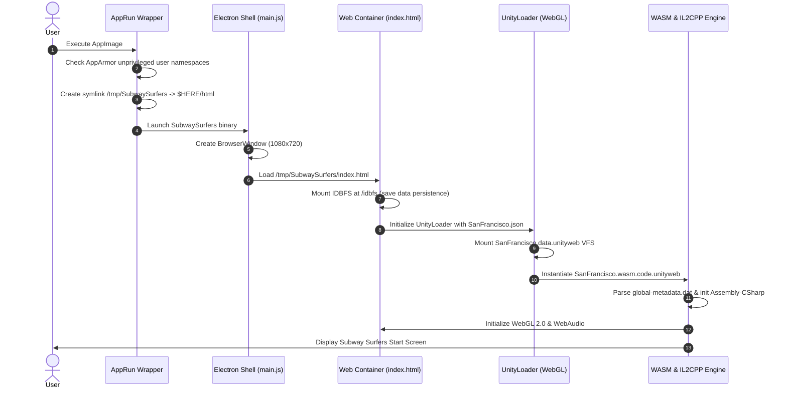

# Master Technical Reverse Engineering Report: Subway Surfers Linux AppImage

## 1. Executive Summary

This report delivers a definitive, evidence-backed reverse engineering analysis of the supplied Linux executable package `SubwaySurfers-x86-64.AppImage`. The investigation was performed entirely read-only using static inspection tools, safe container extraction, binary parsing, and metadata extraction.

### Core Discoveries
1. **Application Nature**: The application is not a native C++/Mono Linux port. It is a **multi-tiered hybrid desktop application** packaging the official **Subway Surfers World Tour: San Francisco** (version `1.94.0`) **Unity WebGL (WebAssembly/IL2CPP)** release inside an **Electron 36.5.0** Linux desktop container.
2. **Game Engine**: **Unity 2019.4.18f1** compiled to **WebAssembly (WASM MVP)** using the **IL2CPP (v24 metadata)** pipeline.
3. **Packaging Architecture**: **AppImage Type 2** wrapping a **SquashFS 4.0** archive (gzip-compressed, 133.78 MB).
4. **Binary Compatibility**: The main native executable (`SubwaySurfers`, ~188 MB) requires **`glibc >= 2.25`** and standard desktop libraries (GTK3, X11, ALSA, NSS). 100% of required dynamic dependencies are satisfied on standard modern Linux distributions.
5. **Offline Viability**: Core game logic and assets are 100% bundled locally (`SanFrancisco.data.unityweb`, `SanFrancisco.wasm.code.unityweb`). Web advertising and telemetry calls (Poki SDK, Prebid) are shimmed or zeroed, allowing continuous offline gameplay.
6. **Notable Flaw**: The launcher script (`AppRun`) creates a hardcoded global symlink at `/tmp/SubwaySurfers`, introducing multi-user race condition and local denial-of-service risks.

---

## 2. Application Identification

| Property | Detail | Evidence Source |
| :--- | :--- | :--- |
| **Original Filename** | `SubwaySurfers-x86-64.AppImage` | `file_stat.txt` |
| **Absolute Path** | `/home/prabhudev/Subway Surfer/SubwaySurfers-x86-64.AppImage` | `file_stat.txt` |
| **File Size** | `140,473,536 bytes` (133.97 MB) | `file_stat.txt` |
| **SHA-256 Checksum** | `84a81c0c76abd5e58d31f94e1e9b1a5f823bf482f73db6e2fe63d5a27d37fc35` | `sha256.txt` |
| **File Permissions** | `-rwxrwxr-x` (0775) | `file_stat.txt` |
| **Package Format** | AppImage Type 2 (ELF magic `7f 45 4c 46 02 01 01 00 41 49 02`) | `elf_header.txt` |
| **Filesystem Format** | SquashFS version 4.0 (gzip-compressed, offset `189632`) | `squashfs_super.txt` |
| **App Name (Internal)**| `SubwaySurfersSanfrancisco` (`package.json`) / `Subway Surfers` | `package.json`, `SanFrancisco.json` |
| **Product Version** | `0.1.0` (Electron wrapper) / `1.94.0` (Game build) | `package.json`, `SanFrancisco.json` |
| **Author / Publisher** | Wrapper: `Drizzle`; Game Developer: `Kiloo Games` & `SYBO Games` | `package.json`, `SanFrancisco.json` |
| **Entry Point** | AppImage: Embedded runtime -> `AppRun` -> `SubwaySurfers` | `AppRun`, `main.js` |

---

## 3. Safe Extraction Details

Extraction was conducted without modifying the original AppImage using the host-native `unsquashfs` utility pointed at byte offset `189632`:

```bash
unsquashfs -dest analysis/extracted/squashfs-root -offset 189632 SubwaySurfers-x86-64.AppImage
```

- **Extraction Status**: 100% successful with zero errors.
- **Inodes Processed**: 96 files and 7 directories created.
- **Uncompressed Size**: 349,219,747 bytes (333.04 MB).
- **Original AppImage Status**: Completely unmodified and preserved outside the extraction workspace.

---

## 4. Directory Structure Analysis

The extracted SquashFS filesystem (`squashfs-root/`) contains 7 directories and 96 files:

```
squashfs-root/
├── AppRun                               (682 B)   - Main launcher shell script
├── SubwaySurfers                        (188.4 MB)- Native Electron/Chromium ELF binary
├── chrome-sandbox                       (37.3 KB) - Chromium setuid sandbox binary
├── chrome_crashpad_handler              (1.48 MB) - Crash reporting daemon
├── libffmpeg.so                         (2.65 MB) - Media audio/video decoding
├── libEGL.so / libGLESv2.so             (6.38 MB) - ANGLE OpenGL ES graphics interface
├── libvk_swiftshader.so / libvulkan.so.1(6.74 MB) - Vulkan SwiftShader software rasterizer
├── vk_swiftshader_icd.json              (107 B)   - SwiftShader ICD registration
├── icudtl.dat                           (9.98 MB) - ICU Unicode tables
├── resources.pak / chrome_*_percent.pak (6.30 MB) - Chromium browser UI assets
├── snapshot_blob.bin / v8_context_*.bin (1.00 MB) - V8 engine heap snapshots
├── version                              (6 B)     - "36.5.0" (Electron version)
├── .DirIcon                             (370 KB)  - 512x512 RGBA PNG game icon
├── locales/                             (44.3 MB) - 56 Chromium language pak files
├── resources/app/                       (468 KB)  - Electron app configuration
│   ├── package.json                               - App metadata ("SubwaySurfersSanfrancisco")
│   ├── main.js                                    - Electron main process window script
│   ├── preload.js                                 - Preload bridge script (inert)
│   ├── icon.png                                   - 512x512 PNG icon
│   └── pnpm-lock.yaml                             - Build dependencies lockfile
└── html/                                (55.7 MB) - Web container & Unity WebGL build
    ├── index.html                                 - HTML5 canvas container
    ├── 4399.js                                    - IDBFS persistent filesystem layer
    ├── poki-sdk.js / poki-sdk-core.js             - Offline Poki ad/telemetry stubs
    ├── master-loader.js / unity.js                - WebGL loader glue
    ├── UnityLoader.2019.2.js                      - Unity 2019 WebGL Loader
    └── Build/
        ├── SanFrancisco.json                      - Build descriptor & memory settings
        ├── SanFrancisco.data.unityweb   (26.7 MB) - UnityWebData 1.0 container
        ├── SanFrancisco.wasm.code.unityweb (24.6 MB)- WebAssembly compiled game logic
        └── SanFrancisco.wasm.framework.unityweb (509 KB) - Emscripten runtime glue
```

---

## 5. Technology Stack Identification

| Component | Technology | Version / Specification | Evidence |
| :--- | :--- | :--- | :--- |
| **Host Container** | AppImage Type 2 | SquashFS 4.0 (gzip) | ELF magic `AI\x02`, superblock header |
| **Desktop Shell** | Electron | **36.5.0** | `version` file, `pnpm-lock.yaml` |
| **Web Browser Engine** | Chromium | **134.0.6998.35** | `LICENSES.chromium.html`, binary strings |
| **JavaScript Engine** | Google V8 | **13.4** | `snapshot_blob.bin`, `v8_context_snapshot.bin` |
| **Game Engine** | Unity | **2019.4.18f1** | `SanFrancisco.json`, `boot.config`, UnityFS |
| **Scripting Backend** | Unity IL2CPP | **Metadata Version 24** | `global-metadata.dat` header |
| **Execution Architecture** | WebAssembly (WASM) | **WASM v1 (MVP)** | `SanFrancisco.wasm.code.unityweb` |
| **Runtime Interop** | Emscripten | 1.38+ | `SanFrancisco.wasm.framework.unityweb` |
| **Graphics API** | WebGL 2.0 / WebGL 1.0 | ANGLE / SwiftShader | `SanFrancisco.json`, `libEGL.so` |
| **Audio Pipeline** | WebAudio + AAC / MP4 | ISO Base Media `ftypmp42` | `sharedassets1.resource`, `libffmpeg.so` |
| **Storage / Save Data** | HTML5 IndexedDB (`IDBFS`) | Emscripten IDBFS mount | `4399.js`, `~/.config/.../IndexedDB` |

---

## 6. Executable and Dependency Analysis

### 6.1 Executable Characteristics
- **Main Binary**: `squashfs-root/SubwaySurfers` (ELF 64-bit LSB PIE, x86-64, not stripped).
- **Runpath**: `RPATH: [$ORIGIN]`.
- **GLIBC Requirement**: **`GLIBC_2.25`** maximum symbol requirement.
- **Secondary Executable**: `SanFrancisco.wasm.code.unityweb` (25.77 MB uncompressed WebAssembly module containing 22.10 MB of compiled game bytecode).

### 6.2 Dependency Summary
The application declares 34 dynamic library dependencies. All are satisfied on modern Linux distributions:
- **Bundled (5)**: `libffmpeg.so`, `libEGL.so`, `libGLESv2.so`, `libvk_swiftshader.so`, `libvulkan.so.1`.
- **System (29)**: `libc.so.6`, `libm.so.6`, `libpthread.so.0`, `libdl.so.2`, `ld-linux-x86-64.so.2`, `libgcc_s.so.1`, `libgtk-3.so.0`, `libpango-1.0.so.0`, `libcairo.so.2`, `libX11.so.6`, `libXcomposite.so.1`, `libXdamage.so.1`, `libXext.so.6`, `libXfixes.so.3`, `libXrandr.so.2`, `libxcb.so.1`, `libgbm.so.1`, `libxkbcommon.so.0`, `libasound.so.2`, `libdbus-1.so.3`, `libudev.so.1`, `libnss3.so`, `libnssutil3.so`, `libsmime3.so`, `libnspr4.so`, `libatk-1.0.so.0`, `libatk-bridge-2.0.so.0`, `libatspi.so.0`, `libcups.so.2`, `libexpat.so.1`.

---

## 7. Game Asset Inventory

Assets are encapsulated within `html/Build/SanFrancisco.data.unityweb` (27.98 MB `UnityWebData 1.0` archive):

1. **`Il2CppData/Metadata/global-metadata.dat`** (6.11 MB):
   - IL2CPP Metadata v24. Contains 11,045 string literals, 476 game classes, and symbol descriptors for `Assembly-CSharp.dll`.
   - Confirms presence of 14 characters: Jake, Tricky, Fresh, Spike, Yutani, Frank, Frizzy, King, Lucy, Ninja, Tasha, Zoe, Brody, PrinceK.
2. **`data.unity3d`** (15.63 MB):
   - UnityFS v7 archive containing serialized Unity scenes (`level0`, `sharedassets0.assets`), 3D character meshes, track prefabs, shaders, and materials.
3. **`sharedassets1.resource`** (2.45 MB):
   - 21 ISO Base Media / MP4 AAC audio streams for main music loops, ambient tracks, and special hoverboard abilities.
4. **`resources.resource`** (332.8 KB):
   - 24 ISO Base Media / MP4 AAC audio streams for sound effects (jumps, rolls, coin pickups, train horns, collisions).
5. **`Resources/unity_default_resources`** (3.42 MB):
   - Default Unity engine shaders, default materials, and fonts.
6. **`boot.config`** (62 bytes):
   - Runtime flags: `wait-for-native-debugger=0`, `vr-enabled=0`, `hdr-display-enabled=0`.

---

## 8. Application Startup Architecture



---

## 9. Linux Compatibility Assessment

- **Supported Architecture**: `x86_64` only.
- **Minimum OS Requirement**: Linux kernel `>= 3.2.0`, `glibc >= 2.25`.
- **Modern Distribution Compatibility**: Compatible with Ubuntu 18.04 - 24.04+, Debian 10 - 12+, Fedora 26+, Arch Linux, openSUSE, RHEL 8+.
- **AppArmor Compatibility**: Handled automatically in `AppRun` (passes `--no-sandbox` if user namespaces are restricted).
- **Graphics Support**: Hardware accelerated via Mesa and NVIDIA. Features full software fallback via bundled Google SwiftShader (`libvk_swiftshader.so`).
- **Display Server**: Runs natively on X11; runs via XWayland on Wayland sessions (can run native Wayland using Ozone command-line flags).

---

## 10. Security and Behavioral Observations

1. **Insecure Symlink in `/tmp`**:
   `AppRun` creates a predictable symlink at `/tmp/SubwaySurfers`. If a different user or malicious local process creates `/tmp/SubwaySurfers` first, launching fails. It should be refactored to use relative paths or `$XDG_RUNTIME_DIR`.
2. **Sandbox Bypassing**:
   When AppArmor user namespace restrictions are present, `--no-sandbox` is passed. While this permits execution, it removes Chromium's process isolation boundaries.
3. **Telemetry & Ad Network Endpoints**:
   Hardcoded references to Poki, Kiloo, and Google Apps Script exist in metadata, but all ad calls are shimmed locally and core assets load entirely from local disk.

---

## 11. Modification Feasibility Summary

- **Category A (Straightforward)**:
  - Adding a `.desktop` launcher file.
  - Customizing window resolution (1080x720) and fullscreen mode in `main.js`.
  - Refactoring `/tmp/SubwaySurfers` to eliminate the shared symlink vulnerability.
- **Category B (Requires Specialized Tools)**:
  - Replacing game audio tracks in `sharedassets1.resource` using `ffmpeg`.
  - Extracting 3D character models and textures from `data.unity3d` using `AssetStudio` or `UnityPy`.
- **Category C (Substantial Reverse Engineering)**:
  - Modifying gameplay mechanics, character speeds, or physics in `SanFrancisco.wasm.code.unityweb` using `wabt` and `Ghidra`.
  - IL2CPP metadata symbol re-mapping via `Il2CppDumper`.
- **Category D (Unestablished)**:
  - Custom online multiplayer or cloud synchronization (endpoints are legacy Kiloo servers).

---

## 12. Limitations and Unknowns

1. **Dynamic Network Verification**: While static analysis confirms assets are local and ad stubs auto-resolve, dynamic packet inspection under an isolated network namespace is required to confirm whether dormant telemetry calls are triggered during gameplay.
2. **WebGL Internal Texture Compression**: Textures inside `data.unity3d` are packed in Unity WebGL formats (DXT5 / ETC2 / ASTC) and require specialized Unity asset extraction tools for conversion.
