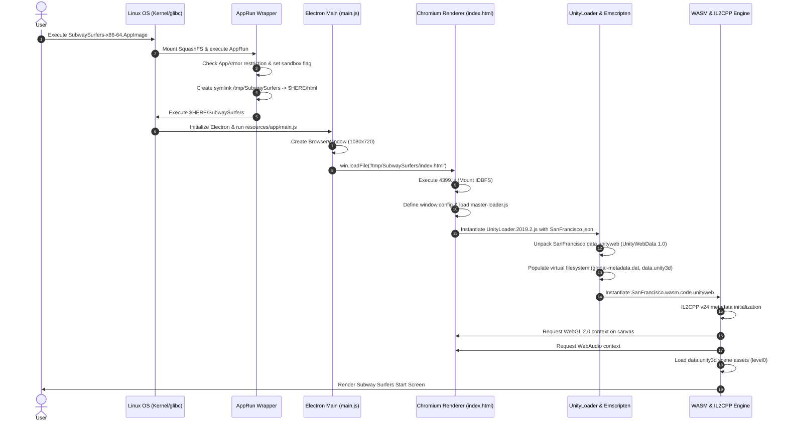

# Application Startup and Execution Flow

## 1. Overview

This document reconstructs the entire application startup sequence of the **Subway Surfers AppImage** using static analysis of the runtime headers, startup wrapper scripts, Electron configuration files, web loaders, and Unity WebGL initialization scripts.

The startup sequence progresses through five distinct abstraction layers:
1. **Host OS & AppImage Runtime Layer**
2. **Bash Wrapper (`AppRun`) & Environment Layer**
3. **Electron Main Process Layer (`main.js`)**
4. **Chromium Renderer & Web Platform Layer (`index.html`)**
5. **Unity WebGL & IL2CPP WebAssembly Game Engine Layer**

---

## 2. Mermaid Startup Flowchart

```mermaid
flowchart TD
    subgraph Host ["1. Host Operating System"]
        A["User / OS executes SubwaySurfers-x86-64.AppImage"] --> B["AppImage ELF Runtime (Type 2)"]
        B --> C{"Check FUSE / squashfuse"}
        C -->|Standard| D["Mount SquashFS at /tmp/.mount_SubwayXXXXXX"]
        C -->|--appimage-extract| E["Extract SquashFS to filesystem"]
    end

    subgraph Wrapper ["2. AppRun Wrapper Script"]
        D --> F["Execute AppRun"]
        E --> F
        F --> G{"Check /proc/sys/kernel/apparmor_restrict_unprivileged_userns"}
        G -->|Restriction == 1| H["Set sandbox='--no-sandbox'"]
        G -->|Restriction != 1| I["sandbox=''"]
        H --> J["export appimage=true"]
        I --> J
        J --> K["Remove existing symlink /tmp/SubwaySurfers"]
        K --> L["ln -s $HERE/html /tmp/SubwaySurfers"]
        L --> M["Launch $HERE/SubwaySurfers $sandbox $@"]
    end

    subgraph Electron ["3. Electron Runtime Shell"]
        M --> N["Initialize Chromium & Node.js Main Process"]
        N --> O["Execute resources/app/main.js"]
        O --> P["Create BrowserWindow (1080x720, icon.png, autoHideMenuBar)"]
        P --> Q{"Check process.env.appimage"}
        Q -->|True| R["win.loadFile('/tmp/SubwaySurfers/index.html')"]
        Q -->|False| S["win.loadFile('.../html/index.html')"]
    end

    subgraph Renderer ["4. Chromium Renderer & Web Stack"]
        R --> T["Load html/index.html"]
        S --> T
        T --> U["Execute html/4399.js: Mount IDBFS at /idbfs"]
        U --> V["Define window.config (Unity 2019.4.18f1, SanFrancisco.json)"]
        V --> W["Execute html/master-loader.js"]
        W --> X["Load html/poki-sdk.js -> poki-sdk-core.js (Local Stub)"]
        X --> Y["Load html/unity.js & UnityLoader.2019.2.js"]
    end

    subgraph UnityEngine ["5. Unity WebGL & IL2CPP WASM Engine"]
        Y --> Z["Fetch html/Build/SanFrancisco.json"]
        Z --> AA["Download & Parse SanFrancisco.data.unityweb (UnityWebData 1.0)"]
        AA --> AB["Mount Virtual VFS: global-metadata.dat, boot.config, data.unity3d, resources"]
        AB --> AC["Load SanFrancisco.wasm.framework.unityweb (Emscripten Glue)"]
        AC --> AD["Instantiate SanFrancisco.wasm.code.unityweb (WebAssembly Module)"]
        AD --> AE["Initialize IL2CPP Runtime (Metadata v24)"]
        AE --> AF["Initialize WebGL 2.0 Canvas Context via ANGLE / SwiftShader"]
        AF --> AG["Initialize WebAudio Context via Chromium / ALSA"]
        AG --> AH["Load scenes from data.unity3d (level0)"]
        AH --> AI["Start Subway Surfers Core Gameplay Loop"]
    end
```



---

## 3. Step-by-Step Initialization Sequence

### Step 1: AppImage Runtime Initialization
- The user or desktop environment launches `SubwaySurfers-x86-64.AppImage`.
- The embedded AppImage Type 2 runtime ELF header (first 189,632 bytes) initializes.
- It examines command-line flags. If `--appimage-extract` is supplied, it extracts the SquashFS archive located at offset `189632` and terminates.
- In standard execution, it uses `squashfuse` to mount the embedded SquashFS payload (compressed with gzip, 140,279,847 bytes) to a temporary mount point (typically `/tmp/.mount_SubwayXXXXXX`).
- It sets the environment variable `APPDIR` pointing to this mount path and executes `$APPDIR/AppRun`.

### Step 2: Launcher & Sandbox Verification (`AppRun`)
- `AppRun` determines its directory using `HERE="$(dirname "$(readlink -f "${0}")")"`.
- It performs a defensive compatibility check against modern Linux security modules:
  ```bash
  restriction=$(cat /proc/sys/kernel/apparmor_restrict_unprivileged_userns)
  if [ "$restriction" = "1" ]; then
      sandbox="--no-sandbox"
  fi
  ```
  *(This specifically prevents crashes on Ubuntu 24.04 LTS and Debian kernels where unprivileged user namespaces are restricted by default).*
- Sets `export appimage=true`.
- Checks for `/tmp/SubwaySurfers` and removes any preexisting symbolic link.
- Creates a symbolic link:
  ```bash
  ln -s "$HERE/html" /tmp/SubwaySurfers
  ```
- Executes the main binary: `"$HERE/SubwaySurfers" "$sandbox" "$@"`.
- Traps exit to remove the `/tmp/SubwaySurfers` symlink upon application shutdown.

### Step 3: Native Executable & Dynamic Library Loading
- The Linux kernel ELF loader (`/lib64/ld-linux-x86-64.so.2`) maps `SubwaySurfers` into memory.
- It resolves `$ORIGIN/libffmpeg.so` from the application directory.
- It links against host system libraries (`libc.so.6`, `libgtk-3.so.0`, `libX11.so.6`, `libasound.so.2`, `libnss3.so`, `libdbus-1.so.3`).
- All GLIBC symbol requirements (`GLIBC_2.2.5` through `GLIBC_2.25`) are verified and bound.

### Step 4: Electron & Node.js Runtime Initialization
- The Chromium browser engine initializes thread pools, IPC channels, and the V8 JavaScript engine.
- Node.js initializes its event loop and loads `resources/app/package.json` (`main: "main.js"`).
- The main script `resources/app/main.js` is executed:
  - Configures `BrowserWindow` properties: width `1080`, height `720`, `autoHideMenuBar: true`, icon `icon.png`.
  - Sets up keyboard navigation events (Alt+Left/Right for history).
  - Checks `process.env.appimage`:
    - If `true`: loads `win.loadFile('/tmp/SubwaySurfers/index.html')`.
    - If `false`: loads `win.loadFile(path.join(path.dirname(process.execPath), 'html', 'index.html'))`.

### Step 5: Chromium GPU Process & Graphics Subsystem
- Chromium launches a dedicated GPU process.
- The GPU process initializes ANGLE (`libEGL.so` and `libGLESv2.so`).
- It tests for hardware acceleration via host graphics drivers (Mesa / NVIDIA).
- If hardware acceleration is unavailable, it queries `vk_swiftshader_icd.json` and initializes `libvk_swiftshader.so` (Google SwiftShader Vulkan software rasterizer).
- A WebGL 2.0 / WebGL 1.0 rendering context is created for the HTML5 canvas.

### Step 6: Chromium Audio Subsystem
- Chromium initializes the audio service.
- Connects to host audio via ALSA (`libasound.so.2`), which routes through PulseAudio or PipeWire.
- Provides standard WebAudio API and HTML5 `<audio>` elements to the renderer.

### Step 7: Web Container & Portal SDK Stubs
- `html/index.html` loads inside the renderer:
  - Executes `4399.js`: Initializes Emscripten VFS hooks, creating `/idbfs` and mounting `IDBFS` (IndexedDB File System) so `PlayerPrefs` and save data persist.
  - Declares global configuration `window.config`:
    - `unityVersion: '2019.4.18f1'`
    - `unityWebglBuildUrl: 'Build/SanFrancisco.json'`
    - `TOTAL_MEMORY: 369098752` (~352 MB)
  - Loads `master-loader.js`, which sets `window.config.unityWebglLoaderUrl = "./UnityLoader.2019.2.js"`.
  - Loads `poki-sdk.js` and `poki-sdk-core.js`: Local stubs satisfying `window.PokiSDK` commercial/rewarded ad callbacks without requiring active internet connectivity.
  - Loads `unity.js` and `UnityLoader.2019.2.js`.

### Step 8: Unity Virtual File System & Asset Loading
- `UnityLoader.2019.2.js` reads `Build/SanFrancisco.json`.
- Fetches `Build/SanFrancisco.data.unityweb` (27.98 MB).
- Parses the `UnityWebData1.0` header table and mounts 7 files into Emscripten memory:
  - `Resources/unity_default_resources`
  - `Managed/mono/4.0/machine.config`
  - `Il2CppData/Metadata/global-metadata.dat`
  - `boot.config`
  - `data.unity3d`
  - `resources.resource`
  - `sharedassets1.resource`

### Step 9: WebAssembly & IL2CPP Initialization
- Fetches `Build/SanFrancisco.wasm.framework.unityweb` (JavaScript Emscripten glue).
- Compiles and instantiates `Build/SanFrancisco.wasm.code.unityweb` (25.77 MB WebAssembly binary).
- The Unity IL2CPP runtime reads `Il2CppData/Metadata/global-metadata.dat` (Metadata version 24).
- C# types, static constructors, and assemblies (`Assembly-CSharp.dll`, `UnityEngine.CoreModule.dll`, etc.) are initialized.
- Reads `boot.config` (`wait-for-native-debugger=0`, `vr-enabled=0`, `hdr-display-enabled=0`).

### Step 10: Game Scene Loading & Execution
- Unity loads the primary game asset bundle from the mounted `data.unity3d` file.
- Scene 0 / Scene 1 (`level0`, `sharedassets0.assets`, `sharedassets1.resource`) is unpacked.
- The Subway Surfers game systems initialize:
  - `CharacterController`, `TrackManager`, `CoinManager`, `HoverboardManager`, `AudioController`.
- PlayerPrefs and high scores are loaded from `/idbfs`.
- The main menu screen renders on canvas, awaiting user input.

---

## 4. Mermaid Sequence Diagram


